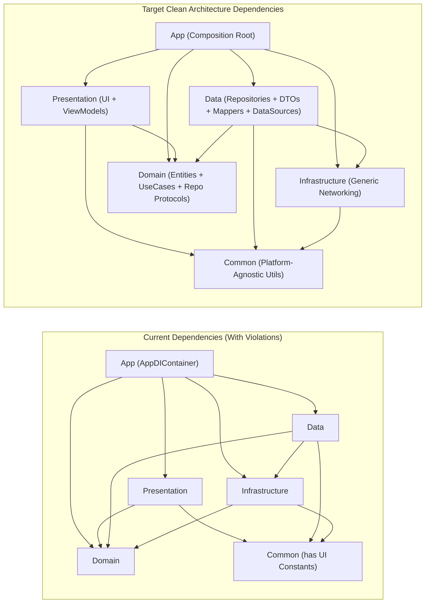

# Clean Architecture Audit & Remediation Plan

## Goal Description

Audit the `CryptoCoinTask` iOS repository against Robert C. Martin's (Uncle Bob's) Clean Architecture principles—specifically **The Dependency Rule**, the four concentric layers (**Entities**, **Use Cases**, **Interface Adapters**, **Frameworks & Drivers**), and **Component Principles** (CCP/CRP)—and remediate the identified boundary violations and structural gaps.

### Current Architecture vs. Target Clean Architecture



---

## Audit Findings: What Works Well vs. Issues Found

### What Already Adheres Well
- **Modularized Swift Packages** (`Domain`, `Data`, `Infrastructure`, `Presentation`, `Common`) enforce compile-time dependency boundaries.
- **`Presentation` is decoupled from `Data` and `Infrastructure`**: `Presentation/Package.swift` only depends on `Domain` and `Common`.
- **Composition Root**: `AppDIContainer.swift` centralizes dependency wiring outside feature modules.
- **CoreData Isolation**: `CryptoCoinCoreData` managed objects stay inside `Data` and are mapped to `CryptoCoinEntity` via `CryptoCoinCoreData.toDomain()`.

### Clean Architecture Violations & Improvement Areas

1. **`Domain` Entity Coupled to External JSON Format (`CryptoCoinEntity.swift`)**
   - `CryptoCoinEntity` conforms to `Decodable` and defines `CodingKeys` (`is_active`, `is_new`).
   - **Violation**: Entities (innermost circle) must not know about external wire formats or JSON serialization. If the API schema changes, `Domain` must change. Additionally, `type: String` leaks raw API string values (`"coin"`, `"token"`) into `Domain` and `Presentation`.

2. **`Infrastructure` Depends on `Domain` (`Infrastructure/Package.swift`, `APIServiceProtocol.swift`, `NetworkServiceManager.swift`)**
   - `Infrastructure` imports `Domain`, hardcodes the crypto endpoint path (`/janeshsutharios/REST_GET_API/refs/heads/main/crypto-coins.json`), and decodes `[CryptoCoinEntity]` directly.
   - **Violation**: Frameworks & Drivers (`Infrastructure`) is the outermost generic technical layer and must **never** depend on `Domain` or know about feature-specific endpoints/entities.

3. **Persistence/Transport Mechanisms Leaking into `Domain` (`CryptoRepositoryProtocol.swift`, `FetchCryptoCoinsUseCase.swift`)**
   - `CryptoRepositoryProtocol` exposes `getCryptoCoinsFromNetwork()`, `getCryptoCoinsFromCache()`, and `saveCryptoCoinsIntoCache(_:)`.
   - `FetchCryptoCoinsUseCaseProtocol` exposes `execute(fromNetwork: Bool)`.
   - **Violation**: Domain boundaries should express business intent, not storage/transport mechanisms ("network" vs. "cache"). These extra methods are unused by `Presentation` and violate Interface Segregation (ISP).

4. **Application Business Rules & Domain Entity Exposure in `Presentation` (`CryptoListViewModel.swift`, `CoinListViewController.swift`, `CoinListViewController+Extension.swift`)**
   - Filtering and search combination rules live inside `CryptoListViewModel` instead of a Domain Use Case.
   - `CryptoListViewModel` exposes mutable `public var allCoins: [CryptoCoinEntity]` directly (mutated by unit tests), and `CoinListViewController+Extension` inspects `coin.type == "token"` and formats `"(\(coin.symbol))"` directly on the Domain Entity instead of a Presentation display model.

5. **UI/Presentation Constants in `Common` (`Constants.swift`, `Reachability.swift`)**
   - `FilterOption`, `LayoutConstants` (including `samllFontSize` typo), and `Spacing` live in `Common`, which is imported by `Data` and `Infrastructure` (violating Common Reuse Principle).
   - `Reachability.swift` in `Common` is unused dead code.

6. **Core Data Error Reporting & Minor Boundary Issues**
   - `CryptoLocalDataSourceImpl.swift` (line 26–30) catches all Core Data `context.fetch` failures and throws `LocalStorageError.objectNotFound`, conflating a genuine database/store error with a missing record (whereas an empty store returns `[]`).
   - `LocalStorageError` does not conform to `LocalizedError` (it only defines `var localizedDescription: String`, which Swift's `Error.localizedDescription` ignores when typed as `any Error`).
   - `CoreDataHelper.swift` has an unused `import Domain`.
   - `CryptoListViewModel` passes raw `error.localizedDescription` and hardcoded `"Error"` instead of mapping domain/infrastructure errors into user-facing presentation messages.

---

## User Review Required

> [!IMPORTANT]
> **Scope Confirmation**: Implementing all proposed changes below will modify public APIs across `Domain`, `Infrastructure`, `Data`, `Presentation`, and `Common`, along with their corresponding unit tests. Please confirm if you want all 5 phases executed, or only a subset (e.g., only fixing the `Domain`/`Infrastructure` Dependency Rule violations).

## Open Questions

> [!NOTE]
> 1. Should `FetchCryptoCoinsUseCase` continue to be the single use case, or would you like a dedicated `FilterCryptoCoinsUseCase` (pure synchronous/async domain filter) alongside it?
> 2. `Reachability.swift` in `Common` is currently unused—should it be removed or retained?

---

## Proposed Changes

### 1. Domain Layer (Entities, Repository Boundary, Use Cases)

#### [MODIFY] `JaneshSutharCryptoDemoiOS/Packages/Domain/Sources/Domain/Entities/CryptoCoinEntity.swift`
- Remove `Decodable` conformance and `CodingKeys` from `CryptoCoinEntity`.
- Introduce a domain `CoinType` enum (`case coin`, `case token`, `case unknown(String)`) or keep strong domain semantics without JSON coupling.
- Add `Equatable, Hashable, Sendable` conformance.

#### [MODIFY] `JaneshSutharCryptoDemoiOS/Packages/Domain/Sources/Domain/Repositories/CryptoRepositoryProtocol.swift`
- Simplify the boundary to business-level intent:
```swift
public protocol CryptoRepositoryProtocol: Sendable {
    func fetchCryptoCoins() async throws -> [CryptoCoinEntity]
}
```

#### [MODIFY] `JaneshSutharCryptoDemoiOS/Packages/Domain/Sources/Domain/UseCases/FetchCryptoCoinsUseCase.swift`
- Remove `execute(fromNetwork: Bool)` so the use case does not leak transport/cache mechanisms.
- Add a domain filter/search use case (or pure domain `CoinFilterCriteria` + `FilterCryptoCoinsUseCase`) so filtering/searching rules live in `Domain`.

---

### 2. Infrastructure Layer (Generic Networking Only)

#### [MODIFY] `JaneshSutharCryptoDemoiOS/Packages/Infrastructure/Package.swift`
- Remove `"Domain"` from `dependencies` and `target` dependencies. `Infrastructure` will depend only on `Common` (or nothing if `Common` is not needed).

#### [MODIFY] `JaneshSutharCryptoDemoiOS/Packages/Infrastructure/Sources/Infrastructure/Network/NetworkManager.swift`
- Extract a generic `NetworkClientProtocol: Sendable` (`func request<T: Decodable>(endpoint: Endpoint) async throws -> T`) implemented by `NetworkManager`, so `Data` can depend on an abstraction rather than `NetworkServiceManager` tied to `Domain`.

#### [DELETE] `JaneshSutharCryptoDemoiOS/Packages/Infrastructure/Sources/Infrastructure/Network/Protocols/APIServiceProtocol.swift`
#### [DELETE] `JaneshSutharCryptoDemoiOS/Packages/Infrastructure/Sources/Infrastructure/Network/NetworkServiceManager.swift`
- Move feature-specific endpoint knowledge and DTO decoding out of `Infrastructure` into `Data`.

---

### 3. Data Layer (DTOs, Mappers, DataSources, Repository)

#### [NEW] `JaneshSutharCryptoDemoiOS/Packages/Data/Sources/Data/DataSources/Network/DTOs/CryptoCoinDTO.swift`
- Define `CryptoCoinDTO: Decodable, Sendable` with the snake_case `CodingKeys` (`is_active`, `is_new`) and `func toDomain() -> CryptoCoinEntity`.

#### [MODIFY] `JaneshSutharCryptoDemoiOS/Packages/Data/Sources/Data/DataSources/Network/CryptoNetworkDataSourceImpl.swift`
- Depend on `any NetworkClientProtocol` from `Infrastructure`, build the crypto `Endpoint`, decode `[CryptoCoinDTO]`, and map to `[CryptoCoinEntity]`.

#### [MODIFY] `JaneshSutharCryptoDemoiOS/Packages/Data/Sources/Data/Repositories/CryptoRepository.swift`
- Keep `getCryptoCoinsFromNetwork()`, `getCryptoCoinsFromCache()`, and `saveCryptoCoinsIntoCache(_:)` private/internal implementation details of `CryptoRepository` rather than part of `CryptoRepositoryProtocol`.

#### [MODIFY] `JaneshSutharCryptoDemoiOS/Packages/Data/Sources/Data/DataSources/Local/CoreDataHelper.swift`
- Remove unused `import Domain`.

#### [MODIFY] `JaneshSutharCryptoDemoiOS/Packages/Data/Sources/Data/DataSources/Local/LocalStorageError.swift`
- Add `case fetchFailed(any Error)` (and/or `saveFailed(any Error)`) so database failures are distinct from empty results or missing objects.
- Conform `LocalStorageError` to `LocalizedError` (`var errorDescription: String?`).

#### [MODIFY] `JaneshSutharCryptoDemoiOS/Packages/Data/Sources/Data/DataSources/Local/CryptoLocalDataSourceImpl.swift`
- In `fetchCryptoCoins()`, throw `LocalStorageError.fetchFailed(error)` instead of `LocalStorageError.objectNotFound` when `context.fetch` fails, preserving the underlying Core Data error for diagnosis.

---

### 4. Common & Presentation Layers

#### [MODIFY] `JaneshSutharCryptoDemoiOS/Packages/Common/Sources/Utils/Constants.swift`
- Move `FilterOption`, `LayoutConstants` (fixing `samllFontSize` -> `smallFontSize`), and `Spacing` out of `Common` into `Presentation`.

#### [MODIFY] `JaneshSutharCryptoDemoiOS/Packages/Presentation/Sources/Presentation/ViewModels/CryptoListViewModel.swift`
- Make `allCoins` private; expose a presentation display model (`CryptoCoinDisplayItem`) instead of raw `CryptoCoinEntity` to the ViewController.
- Delegate filtering/searching to the Domain `FilterCryptoCoinsUseCase`.

#### [MODIFY] `JaneshSutharCryptoDemoiOS/Packages/Presentation/Sources/Presentation/ViewControllers/CoinListViewController.swift` & `CoinListViewController+Extension.swift`
- Remove `import Domain` (if no longer needed once display items are used) and remove raw `"coin"` / `"token"` string checks from the ViewController.

---

### 5. Composition Root & Tests

#### [MODIFY] `JaneshSutharCryptoDemoiOS/Application/AppDIContainer.swift`
- Wire `NetworkManager` directly into `CryptoNetworkDataSourceImpl` (removing `NetworkServiceManager`) and inject `FilterCryptoCoinsUseCase` into `CryptoListViewModel`.

#### [MODIFY] Unit Tests Across Packages
- Update `DomainTests`, `InfrastructureTests`, `DataTests`, and `PresentationTests` to match the decoupled boundaries and test DTO mapping + domain filtering directly.

---

## Verification Plan

### Automated Tests
Run the full Xcode test suite across all local Swift Packages and the main app test target:
```bash
xcodebuild test \
  -project JaneshSutharCryptoDemoiOS.xcodeproj \
  -scheme JaneshSutharCryptoDemoiOS \
  -destination 'platform=iOS Simulator,name=iPhone 16'
```
*(Exact simulator name will be verified via `xcrun simctl list devices` before running.)*

### Dependency Verification
- Inspect every `Package.swift` and verify `Infrastructure` has zero `Domain` imports, `Domain` has zero `Decodable`/`CodingKeys` or persistence/network concepts, and `Presentation` only interacts with `Domain` via Use Cases and maps entities to view models.
